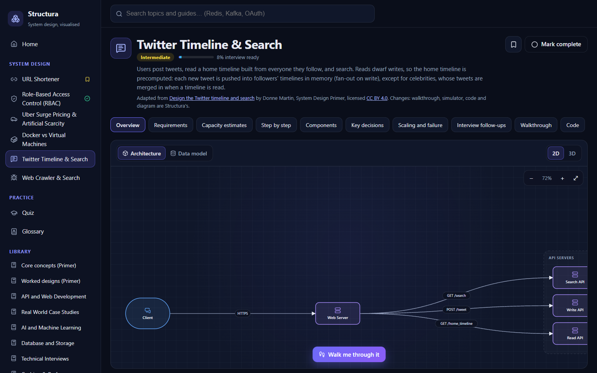

# Structura

**Learn system design by seeing it work, and by listening on the go.**

**Live app: [structura-web.netlify.app](https://structura-web.netlify.app/)**. Installable on Android, iOS and desktop, and works offline.



Every topic is a live architecture, not a static picture:

- **Interactive diagram.** Glowing component cards joined by animated arrows. Click any component to see what it does, its key responsibilities and technologies, and what calls it. Switch parts off (a cache, a broker) and see which requests break.
- **Walkthrough.** Follow one real request step by step, with a packet travelling the arrows and the actual request, cache entry or SQL at each step. Most topics let you try your own input; the Kafka topic uses Kafka's real partitioner.
- **3D load lab.** Switch to a three.js city and put real load on the design with a discrete-event simulator (Rust, compiled to WebAssembly). Watch queues build and the bottleneck light up.
- **Narrated videos.** Vertical explainers made with [Remotion](https://www.remotion.dev/), with chapters, resume and save-for-offline. Every topic gets one automatically.
- **Voice assistant.** Always on screen: ask by voice or text ("what is a load balancer?", "walk me through it", "what should I learn today?"). It answers aloud in a natural voice, drives the app, and highlights each word as it speaks.
- **Commute mode.** Every topic as an offline audio lesson, like a podcast: save on Wi-Fi, listen with the screen off, lock-screen and earphone controls, interview practice with thinking pauses, and it remembers where you stopped.
- **Explanation, code and data model** for each topic, with key takeaways and interview follow-ups.
- **Progress.** Today's pick, bookmarks, completed topics, difficulty levels and an interview-readiness score, saved on your device.
- **Practice.** A quiz and a glossary.
- **Library.** About 1,350 guides, chapters and articles from open system design collections, searchable, as the syllabus for future topics.

Everything runs in your browser: no backend, no accounts, no AI services. The voice is [Kokoro](https://github.com/hexgrad/kokoro), an open-weight speech model that runs on the device.

## Topics

| Topic | Level | Video | Audio lesson | Load test |
| --- | --- | :---: | :---: | :---: |
| URL Shortener | Beginner | ✓ | ✓ | ✓ |
| Role-Based Access Control (RBAC) | Beginner | ✓ | ✓ | ✓ |
| Docker vs Virtual Machines | Beginner | ✓ | ✓ | |
| Uber Surge Pricing & Artificial Scarcity | Advanced | ✓ | ✓ | |
| Twitter Timeline & Search | Intermediate | ✓ | ✓ | |
| Web Crawler & Search | Intermediate | ✓ | ✓ | |
| Kafka: Event Streaming | Intermediate | ✓ | ✓ | |
| Mint: Personal Finance Aggregator | Intermediate | | | |

## Getting started

Requires Node 20+. Rust is **not** needed: the compiled simulator is committed.

```sh
npm install
npm run dev
```

Open http://localhost:5173. To try it on a phone on the same Wi-Fi, open `http://<your-PC's-IP>:5173`.

## Repository

npm workspaces, TypeScript, React 19, Vite, [Motion](https://motion.dev/) for animation.

| Path | What it is |
| --- | --- |
| `apps/web` | The app (PWA): topics, 2D/3D diagrams, walkthroughs, voice assistant, Commute mode, progress, library |
| `apps/video` | Remotion videos: hand-made ones and the automatic topic video template (`npm run studio -w @structura/video`) |
| `packages/shared` | Schemas for diagrams, data models, traces and explanations |
| `packages/sim` | Load simulator in Rust, compiled to WebAssembly (`pkg/` is committed) |

## Scripts

| Command | What it does |
| --- | --- |
| `npm run dev` | Runs the app with hot reload |
| `npm run build` | Builds every workspace |
| `npm run typecheck` | Type-checks every workspace |
| `npm run lan` | Builds and serves the production app on your network |
| `npm run library -w @structura/web` | Refreshes the library from its sources |
| `npm run export:videos -w @structura/web` | Exports topics for the automatic videos |
| `npm run topics -w @structura/video` | Voices and renders the topic videos, and registers them in the app |
| `npm run lessons -w @structura/web` | Voices the Commute-mode audio lessons |
| `npm run render -w @structura/video` | Renders the hand-made videos |
| `npm run build:wasm -w @structura/sim` | Rebuilds the simulator after changing its Rust code (needs Rust and wasm-pack) |

Videos and audio lessons need the Kokoro voice set up once in `apps/video/.venv` (Python 3.10 to 3.12); see [CLAUDE.md](CLAUDE.md#videos-and-audio-lessons).

## Adding topics

Topics are TypeScript files in `apps/web/src/topics/`. [CLAUDE.md](CLAUDE.md) is the authoring guide: the structure, the conventions that make the inspector and walkthrough work, the licensing rules, and how to make the topic's video and audio lesson. Claude Code (including [claude.ai/code](https://claude.ai/code)) reads it automatically, so a new topic can be requested in one sentence and arrives as a pull request with a Netlify preview.

## Deployment

Netlify builds `main` with `netlify.toml` (`npm run build -w @structura/web`, publishing `apps/web/dist`). The site is fully static.

## Credits and licences

Structura's code is MIT licensed ([LICENSE](LICENSE)). Content and tools from other projects are used under their licences:

- **[System Design Primer](https://github.com/donnemartin/system-design-primer)** by Donne Martin, CC BY 4.0. The Twitter Timeline and Web Crawler topics are adapted from it; each topic page credits it.
- **[System Design 101 course](https://github.com/mominurr/system-design-101)** by Mominur Rahman, MIT. The quiz and glossary; notice in [`apps/web/public/licenses`](apps/web/public/licenses).
- **[Awesome Scalability](https://github.com/binhnguyennus/awesome-scalability)** by Binh Nguyen, MIT. Its reading list, in the library.
- **[ByteByteGo System Design 101](https://github.com/ByteByteGoHq/system-design-101)**, CC BY-NC-ND 4.0. Titles and links only, in the library.
- **[System design diagrams](https://github.com/Chaki34/system-design-diagrams)** by Chaki34. Linked only.
- **[Kokoro](https://github.com/hexgrad/kokoro)** speech model (Apache 2.0), via [kokoro-js](https://www.npmjs.com/package/kokoro-js) in the browser and the Python package for videos and lessons.
- Linked references: [Apache Kafka](https://kafka.apache.org/documentation/) (Apache 2.0), [docker-curriculum](https://docker-curriculum.com/) (MIT), [kafka-nodejs-tutorial](https://github.com/billonline33/kafka-nodejs-tutorial), [awesome-system-design-resources](https://github.com/ashishps1/awesome-system-design-resources) (GPL-3.0, link only).
